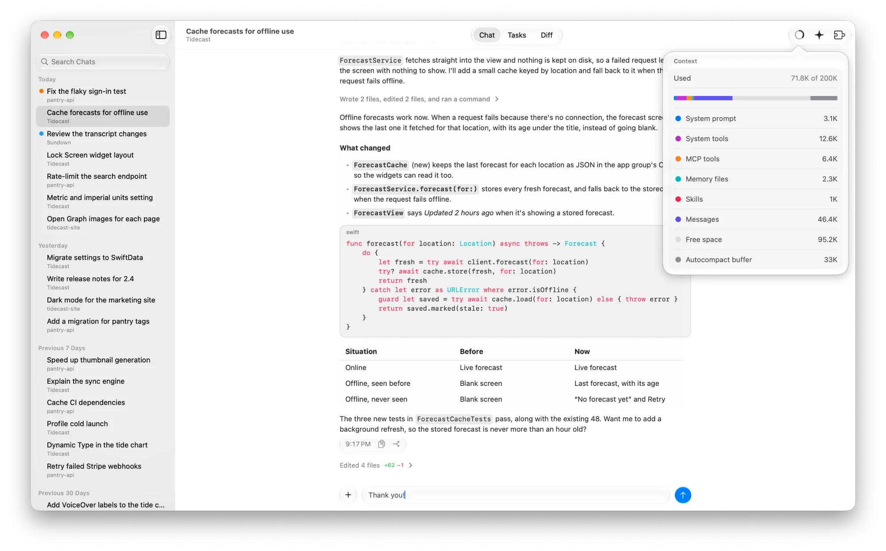
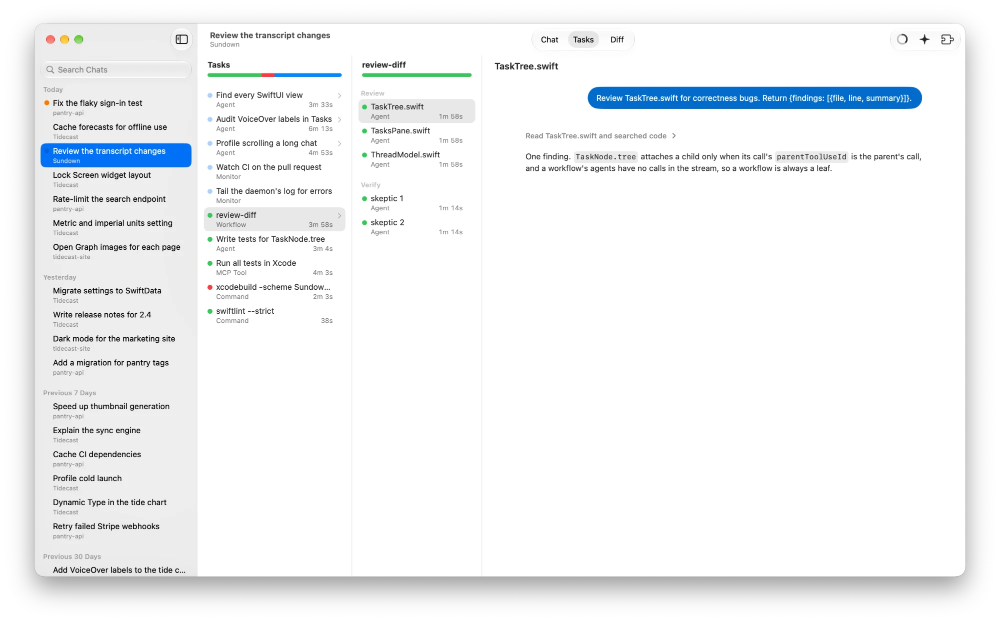
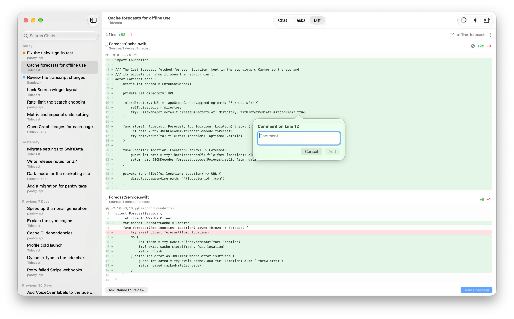
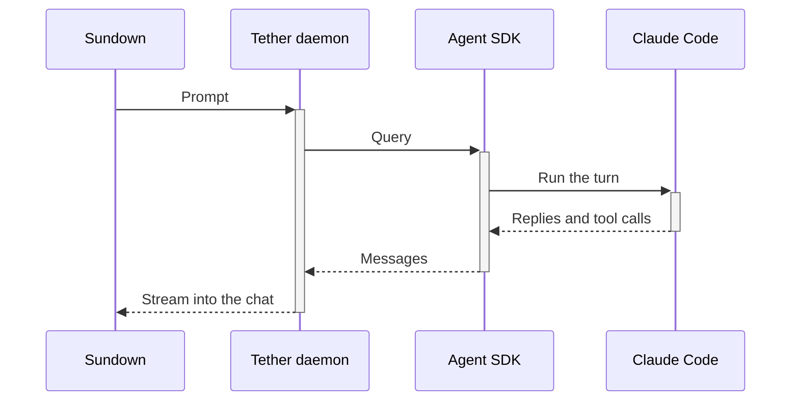

 

# Sundown

A native macOS app for [Claude Code](https://code.claude.com/docs/en/overview) on your Mac or any machine you can SSH into, with long-running sessions and no claude.ai account. Built in SwiftUI with Liquid Glass, and vibe coded with ❤️ by [Hayden Hong](https://haydenhong.com)!

> [!WARNING]
> Sundown is in early development. Expect bugs, or help me fix them by [contributing](#contributing)!

<picture>
  <source media="(prefers-color-scheme: dark)" srcset="docs/screenshots/chat-dark.webp">
  
</picture>

<picture>
  <source media="(prefers-color-scheme: dark)" srcset="docs/screenshots/tasks-dark.webp">
  
</picture>

<picture>
  <source media="(prefers-color-scheme: dark)" srcset="docs/screenshots/diff-dark.webp">
  
</picture>

## Install

Use [Homebrew](https://brew.sh):

```sh
brew install --cask afruitpie/tap/sundown
```

Requires macOS 27. Each host needs Claude Code installed and configured, and Node.js 18+ with `npx` on its login shell's `PATH`.

## How it works

Sundown starts a [Tether](https://github.com/AFRUITPIE/tether-server) daemon on each host, which keeps your sessions running after you quit the app. Like [Remote Control](https://code.claude.com/docs/en/remote-control), you can leave a session running and pick it up later, from any Mac.



## Privacy

Sundown has no telemetry, period. I couldn't afford to track you if I wanted to!

## Contributing

Issues and PRs welcome! Architecture is in [AGENTS.md](AGENTS.md).

## Acknowledgements

Built on [Claude Code](https://code.claude.com) and the [Claude Agent SDK](https://docs.claude.com/en/api/agent-sdk/overview). Not affiliated with Anthropic.

## License

[MIT](LICENSE)