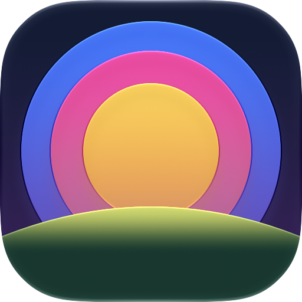
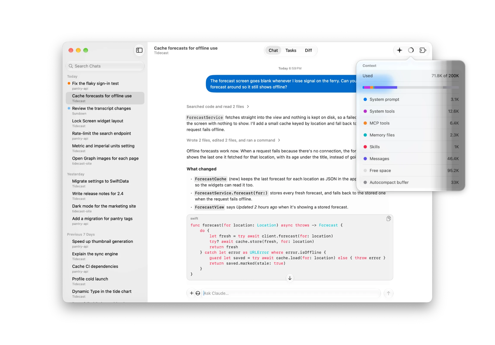
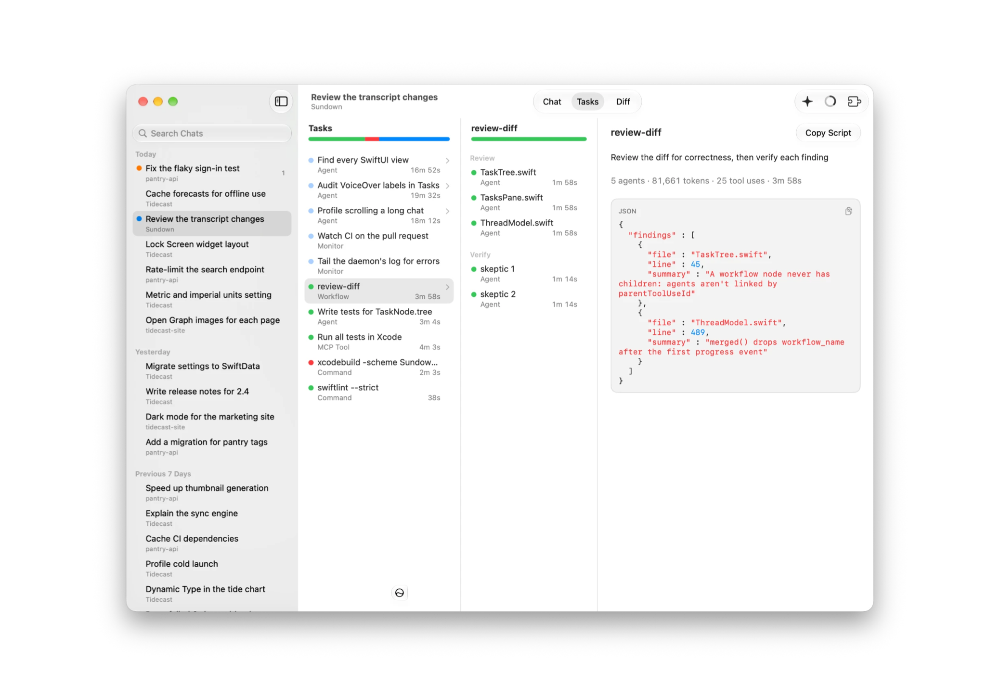
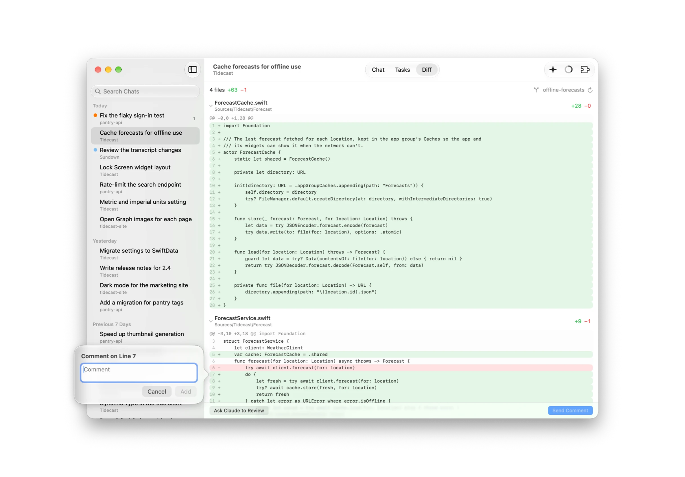

# Sundown

Sundown is a native macOS app for Claude Code.

```sh
brew install --cask afruitpie/tap/sundown
```

<picture>
  <source media="(prefers-color-scheme: dark)" srcset="docs/screenshots/chat-dark.png">
  
</picture>

<picture>
  <source media="(prefers-color-scheme: dark)" srcset="docs/screenshots/tasks-dark.png">
  
</picture>

<picture>
  <source media="(prefers-color-scheme: dark)" srcset="docs/screenshots/diff-dark.png">
  
</picture>
